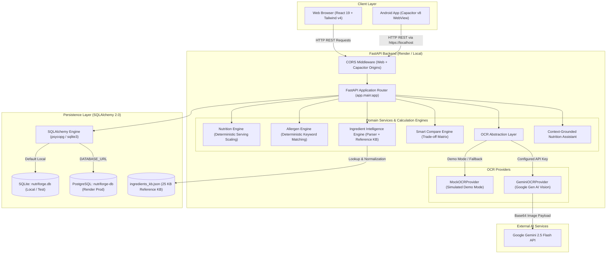
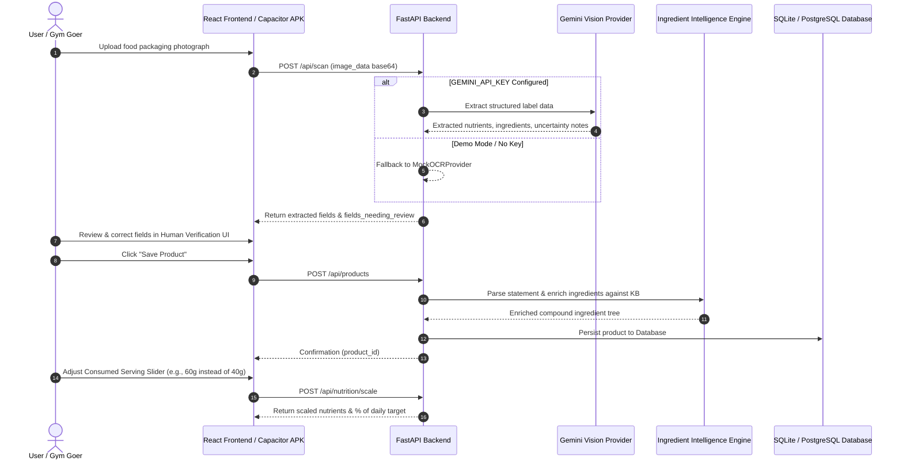

# NutriForge AI 🥗

**Personalized Packaged-Food Intelligence & Food-Label Decision Support for Fitness Communities**

[](https://fastapi.tiangolo.com)
[](https://react.dev)
[](https://www.typescriptlang.org)
[](https://capacitorjs.com)
[](https://ai.google.dev)
[](https://docs.pytest.org)
[](LICENSE)

> **"The label tells you WHAT is in the food. NutriForge helps you understand WHAT IT MEANS FOR YOU."**

NutriForge AI is a nutrition intelligence and food-label literacy platform designed for gym-goers, athletes, and health-conscious consumers. Rather than relying on superficial marketing slogans, front-of-package claims, or isolated protein counts, NutriForge delivers transparent nutrient scaling, deterministic allergen detection, deep ingredient decomposition, and personalized product comparisons.

---

## 🌐 Live Production Deployments

| Component | Platform | URL | Status |
|---|---|---|---|
| **Web Frontend** | Render (Static Site) | [https://nutriforge-frontend.onrender.com](https://nutriforge-frontend.onrender.com) | **Live** |
| **Backend API** | Render (Web Service) | [https://nutriforge-backend-0doa.onrender.com](https://nutriforge-backend-0doa.onrender.com) | **Live** |
| **API Docs (Swagger)** | Render (FastAPI OpenAPI) | [https://nutriforge-backend-0doa.onrender.com/docs](https://nutriforge-backend-0doa.onrender.com/docs) | **Live** |
| **Android APK** | Native Capacitor Build | `frontend/android/app/build/outputs/apk/debug/app-debug.apk` | **Verified (4.07 MB)** |

---

## 🎯 Problem Statement & Philosophy

Packaged foods in fitness spaces frequently use confusing serving sizes, hidden added sugars, non-standard allergen declarations, and misleading claims like *"High Protein"* or *"Zero Refined Sugar"*.

NutriForge operates on four core principles:
1. **Deterministic Arithmetic**: Nutrition values must scale proportionally according to physical mass ($g$) or volume ($ml$), not manufacturer-defined serving marketing tricks.
2. **Transparent Provenance**: Distinguish label-declared values, user-adjusted inputs, calculated values, and demo simulations.
3. **No Hallucinated Safety**: If a nutrient or ingredient is blurred, unreadable, or omitted, it is marked as `null` or `Uncatalogued` with `UNKNOWN` confidence—never assumed to be zero or safe.
4. **Human-in-the-Loop Review**: OCR-extracted data from food packaging is explicitly reviewed and corrected by the user before committing to persistence.

---

## ✨ Implemented Features vs. Roadmap

### ✅ Confirmed Implemented Features
- **Personalized Nutrition Profile & Targets**:
  - Configure fitness goals (`muscle_gain`, `fat_loss`, `endurance`, `general_health`).
  - Declare dietary preferences (`vegan`, `vegetarian`, `keto`, `no_preference`) and custom allergen restrictions.
  - Set custom daily macro and micronutrient targets (calories, protein, carbs, total sugar, added sugar, fats, sodium, fibre).
  - Persistent storage in database with in-memory caching.
- **AI Food-Label OCR & Human Review**:
  - Multi-format packaging label image extraction (JPEG, PNG, WebP, GIF, HEIC up to 10 MB).
  - Powered by Google Gen AI SDK (`gemini-2.5-flash`) with structured Pydantic schema validation.
  - Zero-config **Simulated Demo Mode** for testing without an API key.
  - Visual highlight of uncertain fields (`fields_needing_review`) and observations (`uncertainty_notes`).
  - Full human-in-the-loop verification form to confirm or correct values before saving.
- **Serving Reality Engine**:
  - Interactive serving slider calculating real nutrient intake based on consumed mass.
  - Real-time percentage contribution towards user's daily goals.
  - Rejects negative masses and preserves missing nutrients as `null`.
- **Deterministic Allergen & Restriction Engine**:
  - Flags direct allergens (`CONFIRMED_LABEL_ALLERGEN`), recognized ingredient keywords (`CONFIRMED_INGREDIENT`), and known derivatives (`DERIVATIVE_MATCH`).
  - Evaluates dietary preference conflicts (e.g., dairy whey or gelatin flagged for vegan/vegetarian preferences).
- **Ingredient Intelligence Engine**:
  - Recursive tokenization and parsing of compound ingredient statements with parenthetical clauses.
  - Alias resolution against a 25 KB curated reference knowledge base (`ingredients_kb.json`).
  - Categorization into `CATALOGUED` vs `UNCATALOGUED` with confidence scoring.
- **Smart Compare Engine**:
  - Side-by-side multi-product comparison across 11 standard nutritional metrics.
  - Automated pairwise trade-off analysis (e.g., higher protein vs. lower added sugar) rather than arbitrary "winner" declarations.
  - Highlights allergen alerts specific to the user's active profile.
- **Grounded Nutrition Literacy Assistant**:
  - Context-grounded Q&A explaining nutritional concepts, serving size calculations, added sugars, and allergen safety disclaimers.
- **Dual-Mode Persistence Layer**:
  - Seamless zero-config SQLite (`nutriforge.db`) for local development and test isolation.
  - Production-ready PostgreSQL binding via SQLAlchemy 2.0+ and `psycopg[binary]` (Psycopg 3).
- **Cross-Platform Android App**:
  - Native Android project configured with Capacitor v8 (`com.nutriforge.ai`).
  - Fully local frontend asset bundling inside WebView (no remote iframe or web shortcuts).
  - Custom CORS configuration supporting Android WebView origins (`http://localhost`, `https://localhost`, `capacitor://localhost`).

### 🗺️ Planned & Future Scope
- [ ] Integration with public barcode registries (Open Food Facts / FSSAI database APIs).
- [ ] Multi-lingual packaging label translation (Hindi, regional Indian languages).
- [ ] Real-time camera viewfinder scanner with on-device edge detection.
- [ ] Barcode batch scanning for multi-item grocery hauls.

---

## 🛠️ Technology Stack

| Layer | Technologies | Details |
|---|---|---|
| **Frontend Framework** | React 19, TypeScript 6, Vite 8 | Single Page Application with fast HMR |
| **Styling & Icons** | Tailwind CSS v4, Lucide React | Modern health-tech UI, responsive layout |
| **Client Routing** | React Router DOM v7 | Nested layout routing with SPA fallback |
| **Mobile Runtime** | Capacitor 8 (`@capacitor/android`) | Native Android container with local bundling |
| **Backend API** | FastAPI, Uvicorn, Python 3.11 - 3.14 | Async REST API with OpenAPI documentation |
| **Data Validation** | Pydantic v2 | Strict request/response schema modeling |
| **Database & ORM** | SQLAlchemy 2.0+, SQLite, PostgreSQL | Multi-dialect database layer with auto-migration |
| **PostgreSQL Driver** | Psycopg 3 (`psycopg[binary]`) | Production-tested Render database driver |
| **Vision / AI** | Google Gen AI SDK (`google-genai`) | Model: `gemini-2.5-flash` for structured OCR |
| **Testing** | Pytest 9, HTTPX 0.28, AnyIO | 90 comprehensive backend tests |
| **Linter & Quality** | Oxlint, TypeScript compiler (`tsc -b`) | Zero lint errors, type-safe frontend |

---

## 🏗️ System Architecture



---

## 🔄 Frontend-to-Backend Data Flow



---

## 📂 Repository Directory Structure

```text
nutriforge-ai/
├── backend/                             # FastAPI Python Backend
│   ├── app/
│   │   ├── data/
│   │   │   └── ingredients_kb.json      # 25 KB Reference Ingredient Knowledge Base
│   │   ├── db/
│   │   │   └── database.py              # SQLAlchemy engine, models, and SQLite/PostgreSQL setup
│   │   ├── services/
│   │   │   ├── allergen_engine.py       # Deterministic allergen & restriction matching
│   │   │   ├── compare_engine.py        # Side-by-side product comparison & trade-offs
│   │   │   ├── ingredient_engine.py     # Ingredient intelligence & KB enrichment
│   │   │   ├── ingredient_parser.py     # Recursive ingredient tokenizer & clause parser
│   │   │   ├── nutrition_engine.py      # Proportional serving-size calculations
│   │   │   └── ocr.py                   # Mock & Gemini Vision OCR providers
│   │   ├── main.py                      # FastAPI application entrypoint & API routes
│   │   └── schemas.py                   # Pydantic v2 schemas for all requests/responses
│   ├── tests/                           # Pytest automated test suite (90 tests)
│   │   ├── test_ingredient_engine.py    # 10 tests for ingredient parsing & KB lookup
│   │   ├── test_ingredient_integration.py # 11 tests for end-to-end ingredient intelligence
│   │   ├── test_main.py                 # 9 tests for core endpoints & health checks
│   │   ├── test_ocr_milestone2.py       # 22 tests for OCR validation & Gemini handling
│   │   ├── test_phase2.py               # 6 tests for Phase 2 integration
│   │   ├── test_profile_persistence.py  # 5 tests for profile CRUD & DB persistence
│   │   ├── test_regression_audit.py     # 6 tests for profile, products, and compare safety
│   │   └── test_vertical_slice.py       # 21 tests for complete vertical slice workflows
│   ├── requirements.txt                 # Backend dependencies (fastapi, psycopg, etc.)
│   └── Dockerfile                       # Container definition for backend service
│
├── frontend/                            # React 19 + TypeScript + Vite Frontend
│   ├── android/                         # Capacitor Native Android Project
│   │   ├── app/                         # Android application module & manifests
│   │   │   ├── build.gradle             # Android build script (compileSdk 36)
│   │   │   └── src/main/                # Java MainActivity, splash assets, and res values
│   │   ├── build.gradle                 # Root Android Gradle configuration
│   │   ├── gradlew.bat                  # Gradle Wrapper executable for Windows
│   │   └── local.properties             # Local SDK path (ignored by git)
│   ├── src/
│   │   ├── assets/                      # Icons and visual assets
│   │   ├── components/                  # Shared UI components (Badge, NutritionBar, BrandLogo)
│   │   ├── contexts/                    # ProfileContext for user preferences & targets
│   │   ├── layouts/                     # AppLayout with navigation header & mobile drawer
│   │   ├── pages/                       # Route pages (Dashboard, Scan, ProductAnalysis, etc.)
│   │   ├── services/                    # API client with production Render fallback
│   │   ├── types/                       # TypeScript data contracts & interfaces
│   │   ├── App.tsx                      # React Router configuration
│   │   └── main.tsx                     # Application bootstrap
│   ├── capacitor.config.ts              # Capacitor configuration (com.nutriforge.ai)
│   ├── package.json                     # Frontend scripts & dependencies
│   ├── vite.config.ts                   # Vite configuration with Tailwind CSS v4 plugin
│   ├── tsconfig.json                    # TypeScript compiler configuration
│   └── Dockerfile                       # Multi-stage container build with Nginx
│
├── docs/                                # Technical documentation & design specs
│   ├── architecture/                    # Overview & scanner architecture specs
│   ├── api.md                           # Historical API endpoint notes
│   ├── feature-map.md                   # Feature matrix
│   └── phase-2.md                       # Phase 2 implementation report
│
├── docker-compose.yml                   # Local multi-container development environment
├── render.yaml                          # Render Blueprint infrastructure specification
├── vercel.json                          # Vercel deployment configuration
├── .gitignore                           # Git ignore rules (secrets, venv, node_modules)
└── README.md                            # Project documentation
```

---

## 🔌 API Reference

All routes are prefixed with `/api` unless noted otherwise:

| Method | Endpoint | Description | Request Body / Parameters |
|---|---|---|---|
| `GET` | `/health` / `/api/health` | Service health check | None |
| `GET` | `/api/products` | List all catalog products with enriched ingredient trees | None |
| `GET` | `/api/products/{id}` | Retrieve single product details by ID | Path: `id` |
| `POST` | `/api/products` | Create a new verified product | `ProductBase` JSON |
| `GET` | `/api/products/{id}/nutrition` | Raw nutrition table for a product | Path: `id` |
| `GET` | `/api/products/{id}/ingredients` | Raw and structured ingredient list | Path: `id` |
| `GET` | `/api/products/{id}/ingredient-intelligence` | Full parsed compound tree from knowledge base | Path: `id` |
| `POST` | `/api/ingredients/analyze` | Parse arbitrary raw ingredient text into KB tree | `{"raw_ingredient_text": "..."}` |
| `GET` | `/api/barcode/{barcode}` | Check product by barcode | Path: `barcode` |
| `GET` | `/api/scan/status` | Check Gemini OCR readiness, model name, and limits | None |
| `POST` | `/api/scan` | Extract nutrition and ingredients from image | `{"image_data": "<base64>", "force_demo": false}` |
| `GET` | `/api/profile` | Retrieve saved user profile & daily targets | None |
| `POST` | `/api/profile` | Save/update user profile & daily targets | `ProfileData` JSON |
| `POST` | `/api/nutrition/scale` | Calculate proportional nutrient values for consumed mass | `ScaleServingRequest` JSON |
| `POST` | `/api/allergens/check` | Match ingredients against user allergies & preferences | `AllergenCheckRequest` JSON |
| `POST` | `/api/compare` | Multi-product side-by-side comparison & trade-offs | `CompareRequest` JSON |
| `POST` | `/api/assistant` | Query context-grounded nutrition literacy assistant | `{"query": "...", "context_product_ids": [...]}` |
| `GET` | `/api/dashboard` | Summary of profile goals, priorities, and recent items | None |

---

## 🧮 Deterministic Nutrition & Serving Formulas

### Proportional Serving Scaling
When a product packaging declares nutrient content for a reference serving mass $M_{\text{label}}$ (e.g. $40\text{ g}$), the actual consumed nutrient $N_{\text{consumed}}$ for an individual portion $M_{\text{consumed}}$ (e.g. $60\text{ g}$) is:

$$N_{\text{consumed}} = \frac{N_{\text{label}} \times M_{\text{consumed}}}{M_{\text{label}}}$$

*Example: If a protein bar declares $22\text{ g}$ protein per $40\text{ g}$ serving, eating $60\text{ g}$ yields:*
$$22 \times \frac{60}{40} = 33.0\text{ g protein}$$

### Daily Target Contribution
For any user-defined daily nutrient target $T_{\text{daily}}$ (e.g. $150\text{ g}$ protein), the portion contribution percentage is:

$$C_{\text{target}} = \left( \frac{N_{\text{consumed}}}{T_{\text{daily}}} \right) \times 100$$

$$C_{\text{target}} = \left( \frac{33.0}{150.0} \right) \times 100 = 22.0\%$$

*Implementation Guardrails:*
- Returns `null` if the nutrient was missing or unreadable on the label—never treats missing as $0\text{ g}$.
- Rejects negative consumed mass ($M_{\text{consumed}} < 0$).
- Raises clear validation errors if label serving mass is missing or non-positive ($M_{\text{label}} \le 0$).

---

## 🔐 Environment Variables Reference

### Backend Configuration (`backend/.env`)

| Variable | Required | Default | Description |
|---|---|---|---|
| `PORT` | No | `8000` | Port for the Uvicorn ASGI server |
| `DATABASE_URL` | No | `sqlite:///./nutriforge.db` | Database connection string. Supports SQLite and PostgreSQL (`postgresql://...`) |
| `ALLOWED_ORIGINS` | No | `*` | Comma-separated list of allowed CORS origins or `*` |
| `GEMINI_API_KEY` | Optional | Unset | Google AI Studio API key. When unset, API gracefully provides Simulated Demo Mode |
| `GEMINI_MODEL` | No | `gemini-2.5-flash` | Gemini model variant used for Vision OCR extraction |

### Frontend Configuration (`frontend/.env`)

| Variable | Required | Default | Description |
|---|---|---|---|
| `VITE_API_URL` | No | `http://localhost:8000` (Dev)<br>`https://nutriforge-backend-0doa.onrender.com` (Prod) | Base URL for FastAPI backend endpoints |

> **Security Note:** Never commit `.env` files containing real secrets to source control. Both root and subfolder `.gitignore` files are pre-configured to exclude all `.env*` files except `.env.example`.

---

## 🚀 Getting Started (Local Development)

### Prerequisites
- **Python**: 3.11 or higher
- **Node.js**: 20+ and **npm** 10+
- **Git**
- *(Optional for Android APK)*: Java Development Kit (JDK 21 LTS) and Android SDK (Platform 36, Build-Tools 35/36).

---

### Step 1: Clone the Repository
```bash
git clone https://github.com/yychavan24-eng/nutriforge-ai.git
cd nutriforge-ai
```

---

### Step 2: Set Up and Run the Backend

```bash
# Navigate to backend directory
cd backend

# Create and activate virtual environment
python -m venv venv

# On Windows (Command Prompt / PowerShell):
venv\Scripts\activate

# On macOS / Linux:
source venv/bin/activate

# Install dependencies
pip install --upgrade pip
pip install -r requirements.txt

# (Optional) Set your Gemini API key for live Vision OCR
# If omitted, the app will run in simulated demo mode
export GEMINI_API_KEY="your-gemini-api-key"
# On Windows CMD: set GEMINI_API_KEY=your-gemini-api-key
# On Windows PowerShell: $env:GEMINI_API_KEY="your-gemini-api-key"

# Start FastAPI development server
uvicorn app.main:app --reload --host 127.0.0.1 --port 8000
```
- Interactive API Docs: [http://127.0.0.1:8000/docs](http://127.0.0.1:8000/docs)
- Health Check: [http://127.0.0.1:8000/health](http://127.0.0.1:8000/health)

---

### Step 3: Set Up and Run the Frontend

In a separate terminal window:
```bash
# Navigate to frontend directory
cd frontend

# Install npm dependencies
npm install

# Start Vite development server
npm run dev
```
Open your browser to [http://localhost:5173](http://localhost:5173).

---

### Step 4: Run with Docker Compose (Alternative)

To run the complete stack locally (FastAPI + React/Nginx + PostgreSQL 16) with a single command:
```bash
docker-compose up --build
```
- Frontend: [http://localhost:3000](http://localhost:3000)
- Backend: [http://localhost:8000](http://localhost:8000)
- PostgreSQL: `localhost:5432`

---

## 🧪 Testing & Code Quality

### Run Backend Tests (Pytest)
From the `backend/` directory:
```bash
python -m pytest tests/ -v
```
**Actual Test Results:**
```text
tests/test_ingredient_engine.py ..........                               [ 11%]
tests/test_ingredient_integration.py ...........                         [ 23%]
tests/test_main.py .........                                             [ 33%]
tests/test_ocr_milestone2.py ......................                      [ 57%]
tests/test_phase2.py ......                                              [ 64%]
tests/test_profile_persistence.py .....                                  [ 70%]
tests/test_regression_audit.py ......                                    [ 76%]
tests/test_vertical_slice.py .....................                       [100%]

======================== 90 passed in 6.38s ========================
```

### Run Frontend Linting & Production Build
From the `frontend/` directory:
```bash
# Type check and build Vite bundle
npm run build

# Run Oxlint
npm run lint
```
**Actual Verification Results:**
- `npm run build`: Production bundle generated cleanly (`dist/assets/index-DX5-0Suy.js` 410 kB).
- `npm run lint`: **0 errors**.

---

## 📱 Building the Android APK (Capacitor)

The repository includes a configured native Android platform using Capacitor v8.

### 1. Build Frontend & Sync Native Assets
```bash
cd frontend
npm run cap:build
```
*(This compiles Vite into `dist/` and runs `npx cap sync android` to copy assets into `android/app/src/main/assets/public/`).*

### 2. Assemble Debug APK via Gradle
```bash
cd android
.\gradlew.bat assembleDebug
```

### 3. Output Location
Upon successful build, the debug APK is located at:
```text
frontend/android/app/build/outputs/apk/debug/app-debug.apk
```
*Tested artifact size: ~4.07 MB.*

---

## ☁️ Deployment Guide (Render)

The application is deployed using Render Blueprints declared in [render.yaml](render.yaml):

1. **Backend Web Service (`nutriforge-backend`)**:
   - Runtime: Python
   - Build Command: `pip install --upgrade pip && pip install -r requirements.txt`
   - Start Command: `uvicorn app.main:app --host 0.0.0.0 --port $PORT`
   - Health Check Path: `/health`
   - Bound Database: `nutriforge-db` (PostgreSQL) via connection string environment variable.
2. **Frontend Static Site (`nutriforge-frontend`)**:
   - Runtime: Static
   - Build Command: `npm install && npm run build`
   - Publish Path: `./dist`
   - SPA Routing: Rewrite all requests `/*` to `/index.html`.
   - API Binding: Auto-bound `VITE_API_URL` to backend service host.
3. **Database (`nutriforge-db`)**:
   - Managed PostgreSQL database resource.

---

## ⚠️ Responsible Use & Medical Disclaimer

> **IMPORTANT NOTICE:**
>
> NutriForge AI is an educational label-literacy and nutritional decision-support tool.
>
> - **NOT Medical Advice**: NutriForge does not provide medical diagnoses, clinical allergy assessments, or individualized disease management plans. Always consult a certified physician, registered dietitian, or allergist for personal medical advice.
> - **Cross-Contamination & Formulation Changes**: Packaging visual scans and ingredient checks evaluate only declared information on the scanned label. They cannot detect undeclared shared-equipment cross-contamination, factory processing risks, or unannounced manufacturer formulation revisions.
> - **OCR Verification Required**: Vision-based OCR may misread small print, curved packaging, or blurred text. Always inspect extracted values against the physical label before saving or acting on them.

---

## 📄 License & Attribution

This project is open-source software licensed under the [MIT License](LICENSE).

Developed for community food-label literacy, transparent nutritional decision support, and fitness education.
